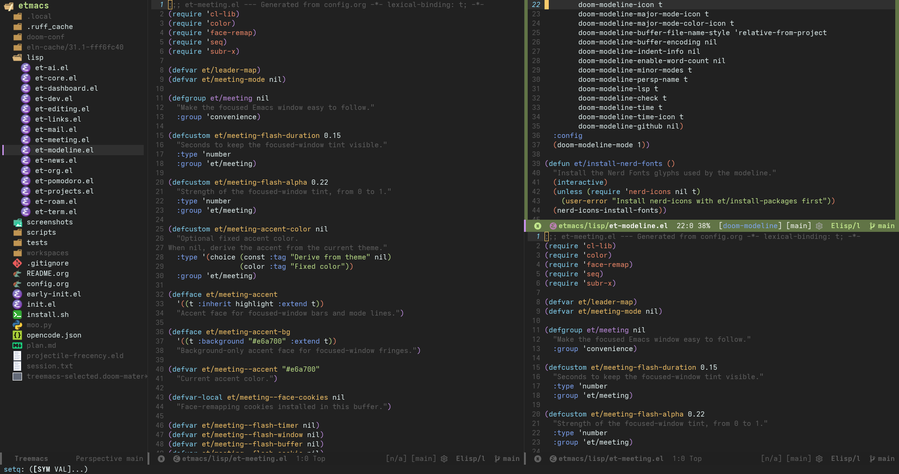
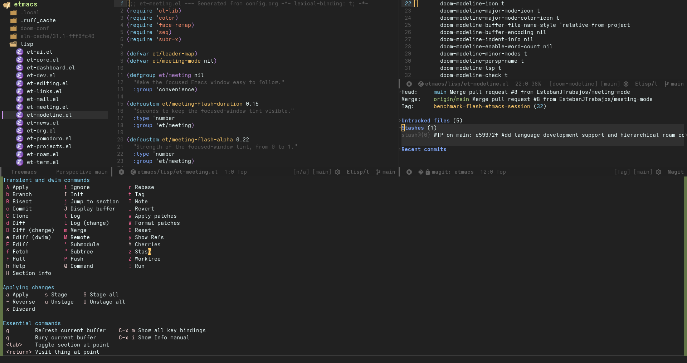
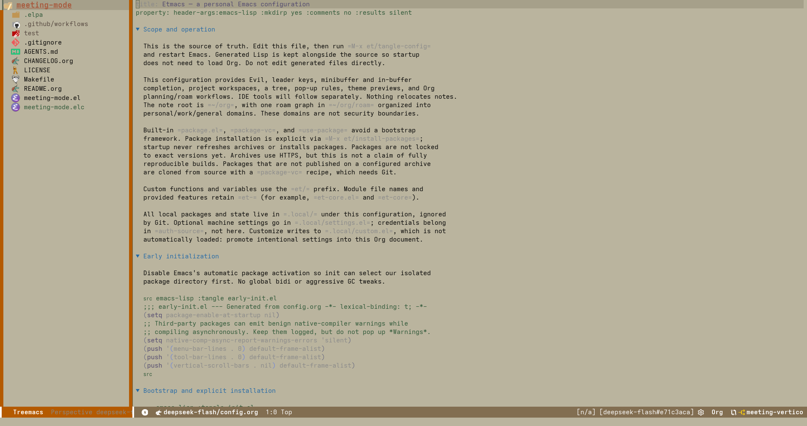
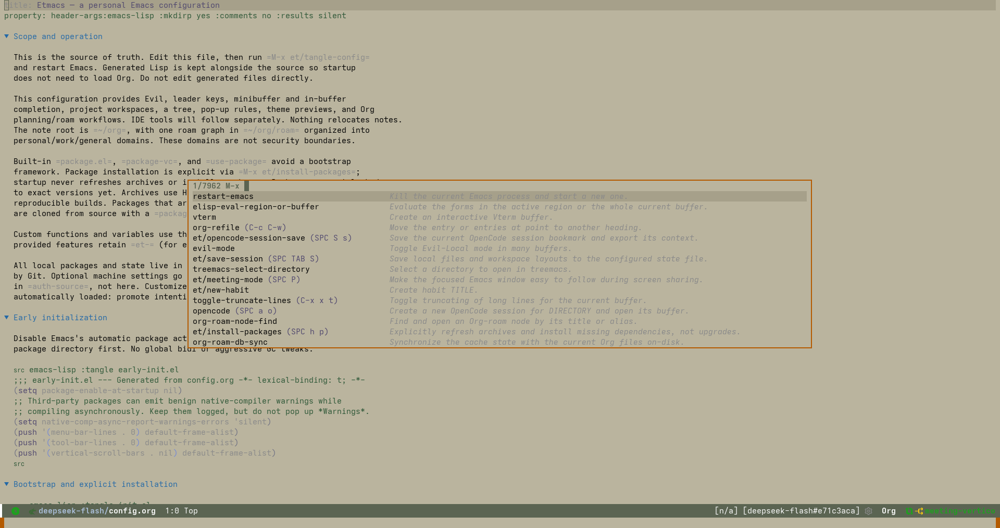

#+title: meeting-mode
#+author: Esteban Trabajos
#+options: toc:2

[[https://github.com/estebanjtrabajos/meeting-mode/actions/workflows/ci.yml][file:https://github.com/estebanjtrabajos/meeting-mode/actions/workflows/ci.yml/badge.svg]]

=meeting-mode= makes the focused Emacs window easy to follow while sharing a
screen. When focus changes, it briefly tints the newly focused window and keeps
a theme-derived accent on that window's fringe, mode line, header line, and tab
line.

* Features

- Blinks the newly focused window a configurable number of times.
- Keeps a thin accent on the focused window's fringe, mode line, header line,
  and tab line when those display areas are present.
- Follows ordinary window selection, buffer switches, the active minibuffer,
  multi-frame focus changes, (when available) Transient menus, and the
  (optional) Vertico posframe child frame.
- Derives its accent from the current theme and regenerates it when a theme is
  enabled or disabled.
- Has no default keybinding and no hard dependency on Transient, Vertico
  posframe, or any other third-party package.
- Cleans up its hooks, timers, face remappings, and window parameters when
  disabled.

* Screenshots

#+attr_html: :width 900px
#+caption: Meeting Mode highlighting the focused =lisp/et-modeline.el= source window beside Treemacs in the =doom-material= theme.

#+attr_html: :width 900px
#+caption: Meeting Mode highlighting a Magit transient menu in the =doom-material= theme.

#+attr_html: :width 900px
#+caption: Meeting Mode highlighting Treemacs in the =guava-ceiba= theme.

#+attr_html: :width 900px
#+caption: Meeting Mode highlighting a Vertico posframe completion menu in the =guava-ceiba= theme.

* Requirements

- Emacs 29.1 or newer.
- A graphical frame is recommended for fringe accents. Terminal Emacs still
  supports the mode-line and header-line accents where the terminal and theme
  allow them.
- Transient is optional. Transient menus are followed only when Transient is
  available.
- Vertico posframe is optional. Its floating child frame is accented only when
  `vertico-posframe` is loaded.

* Installation

** MELPA

Once the package is available in MELPA:

#+begin_src emacs-lisp
(use-package meeting-mode
  :ensure t)
#+end_src

** package-vc

Until the MELPA recipe is accepted, install directly from GitHub:

#+begin_src emacs-lisp
(package-vc-install "https://github.com/estebanjtrabajos/meeting-mode")
#+end_src

** Manual

Add this repository to =load-path= and require the feature:

#+begin_src emacs-lisp
(add-to-list 'load-path "/path/to/meeting-mode")
(require 'meeting-mode)
#+end_src

* Usage

There is no default keybinding. Enable the global minor mode and choose a key
that fits your configuration:

#+begin_src emacs-lisp
(require 'meeting-mode)
(keymap-set global-map "C-c m" #'meeting-mode)
(meeting-mode 1)
#+end_src

You can also run =M-x meeting-mode= directly.

Customize the =meeting= group:

#+begin_example
M-x customize-group RET meeting
#+end_example

The main options are:

- =meeting-border-width=: fringe width in pixels for the accent border
  (default 4).
- =meeting-blink-count=: number of times to blink the newly focused window
  (default 2).
- =meeting-blink-interval=: milliseconds from the start of one blink to the
  next. When nil, derive it from =meeting-flash-duration= divided by
  =meeting-blink-count=.
- =meeting-flash-duration=: total seconds for the blink sequence when
  =meeting-blink-interval= is nil (default 0.3).
- =meeting-flash-alpha=: strength of the tint, from 0 to 1.
- =meeting-accent-color=: optional fixed accent color. When nil, the color is
  derived from the current theme.
- =meeting-accent= and =meeting-accent-bg=: faces used for the focused-window
  bars and fringes.

* How it works

The mode adds functions to Emacs's window-selection, window-state,
window-buffer, minibuffer, and theme hooks. On each focus change it marks the
active window with a window parameter and refreshes the window display. The
accent is applied through buffer-local face remappings filtered to the focused
window, so it does not change global face definitions or require a separate
overlay.

Transient normally hides its popup's header and mode lines. While
`meeting-mode' is active, it restores blank accent lines there so the popup
is framed on all four sides. The popup is treated as the focused window even
though Transient leaves the original window selected.

When `vertico-posframe` is loaded, the mode also supplies its theme-derived
accent as the posframe border color and briefly tints the child frame when the
minibuffer opens. Disabling the mode restores the package's normal posframe
border and background.

The flash is a short-lived face remapping that toggles a filtered window
parameter on and off for the configured number of blinks.

* Compatibility and limitations

- Emacs 29.1 or newer is required.
- Fringe accents need a graphical frame. Terminal frames have no fringe, but
  mode-line and header-line remappings may still be visible.
- The accent is only as capable as the current theme. A theme with unusual
  face definitions may need =meeting-accent-color=.
- Focus behavior across multiple frames depends on the window system's focus
  events. =after-focus-change-function= is used where available.
- Vertico posframe accents require `vertico-posframe` to be installed and
  loaded; plain Vertico completion still uses the minibuffer flash.
- The mode has no default keybinding, so it cannot conflict with an existing
  global keymap.
- All state is session-local. Disabling the mode removes its hooks, timers,
  face remappings, and window parameters.

* Development

#+begin_src sh
make all       # check, lint, checkdoc, byte-compile, and test
make test
make lint
make checkdoc
make compile
make check
#+end_src

The test suite runs in a clean Emacs process:

#+begin_src sh
emacs -Q --batch -L . -l test/meeting-mode-tests.el \
  -f ert-run-tests-batch-and-exit
#+end_src

* Credits

The implementation is inspired by =winpulse= (momentary window flashes) and
=selected-window-accent-mode= (focused-window fringes and mode line). Neither
package is required.

* License

GPL-3.0-or-later. See [[file:LICENSE][LICENSE]].
